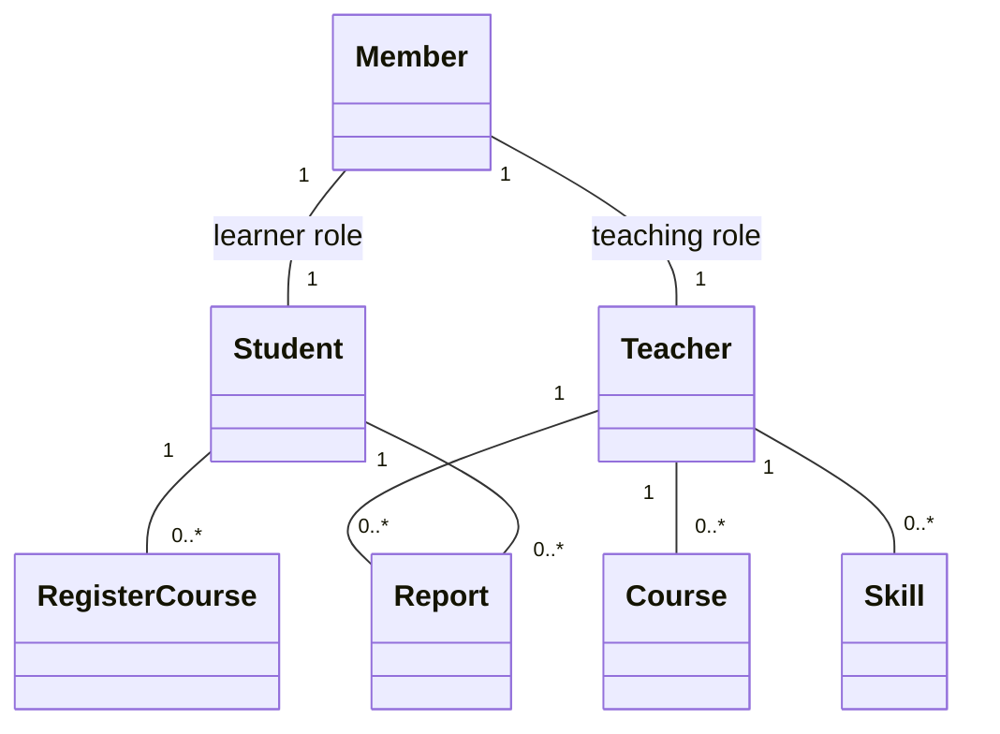

# โครงสร้าง Member / Student / Teacher แบบ One-to-One

ปรับโค้ดเป็นโครงสร้างนี้แล้ว สคริปต์ย้ายฐานข้อมูลเดิมอยู่ใน `member-roles-migration.sql` และยังไม่ได้รันกับฐานข้อมูลจริง

## โครงสร้างปลายทาง

- `members.member_id`: รหัสบัญชีเดิม เก็บชื่อผู้ใช้ ข้อมูลส่วนตัว รูป เครดิต และสถานะแบน
- `student.member_id`: PK และ FK อ้างอิง `members.member_id`
- `teacher.member_id`: PK และ FK อ้างอิง `members.member_id` พร้อม `bio` และ `avgRatingScore`
- บัญชีที่สมัครใหม่มี Student และ Teacher อย่างละหนึ่งรายการ ใช้รหัสบัญชีเดียวกัน
- `register_course.member_id`: อ้างอิง Student แทน Teacher โดยเก็บชื่อคอลัมน์และค่าเดิม
- `report.teacher_member_id`: อ้างอิง Teacher และ `report.student_member_id`: อ้างอิง Student
- `report.reportType`: ผู้เรียน = ผู้สอนรายงานผู้เรียน, ผู้สอน = ผู้เรียนรายงานผู้สอน
- Course และ Skill ยังคงอ้างอิง Teacher



## Mapping ของทั้งสองบทบาท

`Student` และ `Teacher` ใช้ `@MapsId` และ `@OneToOne` ที่ประกาศใน `MemberRole` ซึ่งเป็น `@MappedSuperclass`
คลาสนี้ใช้รวมโค้ดเข้าถึงข้อมูลบัญชี ไม่มีตาราง `member_role` และไม่ใช่การสืบทอด entity จาก Member

```java
// MemberRole: mapping ที่ Student และ Teacher ใช้ร่วมกัน
@Id
@Column(name = "member_id")
private Integer memberId;

@MapsId
@OneToOne(optional = false, cascade = {CascadeType.PERSIST, CascadeType.MERGE})
@JoinColumn(name = "member_id", referencedColumnName = "member_id")
private Member member;
```

Teacher ยกเลิก `extends Member` ส่วน Member ยกเลิก `@Inheritance`
การสมัครและ Seed สร้างบทบาท Student ก่อนบันทึก Teacher จากนั้น cascade จะบันทึก Member และทั้งสองบทบาทใน Transaction เดียว
ข้อมูลส่วนตัวและเครดิตยังอ่านผ่าน getter เดิมได้ โดย getter ของบทบาทส่งต่อไปยัง Member ไม่เก็บข้อมูลซ้ำ

## ส่วนที่ปรับแล้ว

1. Model: Member, Student, Teacher, RegisterCourse และ Report
2. Repository: เพิ่ม StudentRepository และแก้เส้นทาง query ไปยังข้อมูลบัญชีใน Member
3. สมัครสมาชิกและ Seed: สร้างทั้งสองบทบาทให้บัญชีเดียวกัน ไม่สร้างบัญชีซ้ำ
4. ลงทะเบียน/ยกเลิก/อนุมัติ/ส่งมอบเครดิต: อ้างอิง Student สำหรับผู้เรียน และล็อกแถว Member สำหรับเครดิต
5. โปรไฟล์/เข้าสู่ระบบ/แบน/รายงาน/DTO/JSP: อ่านข้อมูลส่วนตัวจาก Member ข้อมูลการสอนจาก Teacher
6. ทดสอบบัญชีเดียวเรียนและสอนได้ การโอนเครดิต การแบน และการเก็บข้อมูลเดิม

## วิธีใช้กับฐานข้อมูลเดิม

1. สำรองฐานข้อมูลและหยุดแอปก่อนย้ายข้อมูล
2. เก็บรหัส Member / Teacher / คอร์ส / การลงทะเบียน / รายงาน / ธุรกรรมเดิมทั้งหมด
3. สร้างตาราง Student แล้วเพิ่ม `member_id` จากสมาชิกเดิม โดยไม่แก้ยอดเครดิต
4. ตรวจว่าแต่ละการลงทะเบียนและรายงานยังอ้างอิงสมาชิกที่มีอยู่
5. เปลี่ยน Foreign Key ของการลงทะเบียนไป Student และของรายงานไป Teacher / Student
6. ตรวจจำนวนข้อมูล ยอดเครดิต และความสัมพันธ์หลังย้ายข้อมูล

ไม่ควรพึ่ง `ddl-auto=update` เพียงอย่างเดียวในการเปลี่ยน Foreign Key ของข้อมูลเดิม
สคริปต์ย้ายข้อมูลต้องแยกจากการเริ่มระบบ และไม่รันกับฐานข้อมูลจริงโดยอัตโนมัติ

## ขั้นตอนเปิดใช้งาน

### ฐานข้อมูลเดิม

1. หยุด Spring Boot และสำรองฐานข้อมูล `skillxskillbycredittime`
2. เปิด `docs/member-roles-migration.sql` ใน MySQL Workbench
3. รันสคริปต์โดยเปิดตัวเลือกหยุดเมื่อเกิดข้อผิดพลาด หากมี error ให้หยุดและแก้ก่อนเริ่มแอป
4. ตรวจผล SELECT ท้ายสคริปต์: จำนวนสมาชิก Student และ Teacher เท่ากัน และ Foreign Key ตรงกับโครงสร้างข้างต้น
5. เริ่ม `SpringBootApplicationMain` แล้ว Refresh ตารางใน MySQL Workbench จะเห็น `student`
6. ไม่จำเป็นต้องรัน `Run.java` กับข้อมูลเดิม เพียงเพื่อสร้างบทบาท Student

### ฐานข้อมูลใหม่

1. สร้างฐานข้อมูลและตั้งค่าการเชื่อมต่อตามคู่มือติดตั้ง
2. รัน `Run.java` เพื่อสร้างข้อมูลตัวอย่างตามเดิม จะมีตาราง Student และบทบาททั้งสองสำหรับทุกบัญชีตัวอย่าง

## การตรวจสอบ

รัน `mvnw.cmd clean test` ผ่าน 93 รายการ รวม 4 รายการที่ทดสอบ JPA จริงใน H2 (MySQL mode)
ทดสอบรหัสร่วมของสองบทบาท การเพิ่มบทบาทให้บัญชีเดิม การแก้เครดิต และการเชื่อมการลงทะเบียน/รายงานทั้งสองทิศทาง
H2 ใช้ฐานข้อมูลในหน่วยความจำ ไม่ใช้ MySQL ที่ตั้งไว้ใน application.properties
สคริปต์ MySQL ได้เตรียมไว้สำหรับตรวจสอบและรันด้วยตนเอง ยังไม่ได้ทดสอบรันกับ MySQL จริง

## โครงสร้าง Report

แต่ละ Report มี Teacher 1 คนและ Student 1 คน อ้างอิงบทบาทของเจ้าของคอร์สและผู้ลงทะเบียน
ใช้ `reportType` ระบุฝ่ายที่ถูกรายงาน จึงไม่เก็บ reporter_member_id / reported_member_id ซ้ำ
`getReporter()` และ `getReportedMember()` คำนวณ Member จากบทบาทและ reportType สำหรับหน้าแอดมินและการแบน
สคริปต์ migration แปลงค่าทั้งสองทิศทาง ตรวจเทียบกับการลงทะเบียน แล้วจึงลบคอลัมน์เดิมและเปลี่ยน Foreign Key
หากเคยรันสคริปต์ฉบับก่อนที่ยังใช้สองคอลัมน์เดิม ให้รันฉบับปรับปรุงนี้ก่อนเปิดระบบ
